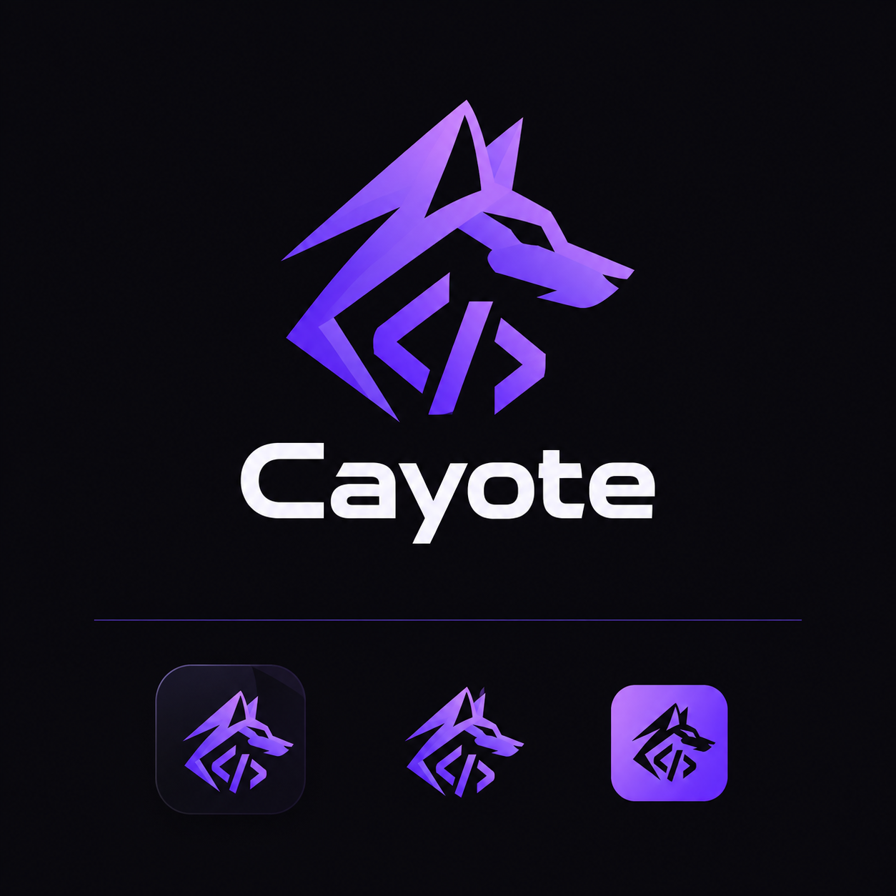

<p align="center">
  
</p>

# Coyote

Coyote is a programming language and toolchain: a C++ compiler that produces a textual,
versioned intermediate language (ML), and the Pixel Virtual Machine (PVM) that verifies and runs
it. Source files use the `.coy` extension.

```
# samples/fibonacci.coy
hand:con println(string text)

method fib(int n) : int {
    if (n < 2) { return n }
    return fib(n - 1) + fib(n - 2)
}

var i = 0
while (i < 10) {
    println("fib(" + i + ") = " + fib(i))
    i = i + 1
}
```

```
$ coyote build samples/fibonacci.coy -o fib.ml
$ pvm fib.ml
fib(0) = 0
fib(1) = 1
...
fib(9) = 34
```

`samples/hello.coy` is the standard "Hello world" (`use "Standard"` + `Shell.PrintLine`); `samples/hello_host.coy` does the same with a raw `hand:` host declaration and no library.

## Implementation status

Coyote is an early work in progress. Only what is marked "working" exists.

| Component | Status |
|-----------|--------|
| Compiler front end (`coyote`) | **Working** for a subset: `int`/`string`/`boolean`/`double`/`char`/`Guid`, `T?` and `null` (`??`, `!`), `obj`, `dyn`, `map<K,V>`, `var`, assignment, expressions (arithmetic, comparison, short-circuit logic, string concatenation), `if`/`else`/`while`/`for`, `namespace`, `use` and `export` across files, namespaces, installed packages and libraries, `++`/`--`, compound assignment on elements, interpolated strings `$"...{x}..."`, several syntax errors per run, `for … in` over arrays, `break`/`continue`, compound assignment, explicit conversions (`int(x)`, `string(x)`, …), `method` with parameters, return values and recursion, `array<T>` (literals, `new`, indexing, `length`, `push`, `copy`), `hand:` host declarations ([language](docs/language.md)) |
| ML generation with `.coy` line mapping | **Working**: the compiler emits ML v5, v6 for function values (lambdas), v7 for class hierarchies and v8 for `try`/`throw`, v9 for `(copy)` of objects/maps, v10 for mouths ([spec](docs/ml-spec.md)); the PVM accepts ML v1 to v10 |
| ML loader and verifier | **Working**, including operand-stack typing across branches and loops |
| PVM interpreter, call frames, host registry with permissions | **Working** (`con.print`, `con.println`); runtime errors for division by zero, `int` overflow, call depth, array bounds/null/size, heap limit |
| Classes, models, constructors, properties, static fields/methods, `public`/`private`/`protected` | **Working** (ML v5 `class`/`global`/`newobj`/`getfield`...; method overloading since 0.6.1) ([docs](docs/language.md)) |
| Inheritance, interfaces, `override`/`base`, `as`/`is` | **Working** (single base class + interfaces, virtual methods through compiler-generated dispatchers; ML v7 only for programs that use it) ([docs](docs/language.md)) |
| Generics (classes, interfaces, top-level methods) | **Working** by compile-time expansion; type arguments of generic methods are inferred from the arguments since 0.6.1 (`First(xs)`; `First<int>(xs)` still works), no generic methods inside classes ([docs](docs/language.md)) |
| Dead-code removal | **Working** (unreachable methods and classes are dropped from the ML; `--keep-unused` disables) ([docs](docs/compiler.md)) |
| Variadic parameters, extension methods | **Working** (compile-time rewrites; [docs](docs/language.md)) |
| Libraries: `use`, `.lib` files, Standard libraries (`Standard.IO`, `.Math`, `.Text` with extension methods, `.Time`, `.Random`, `.Collections`, `.Testing`, HTTP, ...), host functions with return values | **Working**; `.lib` is a **source bundle** (compiled/linked libs are not implemented) ([docs](docs/libraries.md)) |
| Syntax of 0.6.3: `hidden`/`shared`/`here`, `field`/`property` keywords, `locked`/`readonly`, `shared class`, `in (var x of items)`, `public` instead of `export` | **Working** on the PVM ([docs](docs/language.md)) |
| `(copy)` / `(ref)`, constructor overloading, duplicate-free Standard libraries (0.6.5) | **Working** on the PVM: `(copy)` shallow-clones objects, arrays, maps; `(ref)` aliases a local variable (any type); several constructors per class ([docs](docs/language.md)); programs using them run as bundled executables natively |
| Native slices 0.9.0 – 0.9.9 (**stage 0.9 in progress**) | 0.9.9 adds `dyn` members/calls, `random`/`sys.arg`/`env.set`/file-copy-move/directory/`rt` hosts (random numbers now come from one portable generator, so seeded sequences changed); 0.9.8 adds `dyn` operators and boxes of arrays/maps with indexing; 0.9.7 adds `obj` boxes, the `sys` mouths and byte-file/encoding/time-format hosts; 0.9.6 adds length-aware strings, `ocopy` and the `text`/`math`/`time`/`console`/basic `file`/`sys` host functions; 0.9.5 adds `try`/`catch`/`finally`/`throw` (typed catch, runtime errors as exceptions, stack traces); 0.9.4 adds closures (shared variables) and file-level variables; 0.9.3 adds maps, nullable `int?`/`string?` (boxed) and `int("..")` parsing; 0.9.2 adds classes (fields, inheritance, overriding, casts, `Node?`); 0.9.1 a native heap with a garbage collector and arrays (also arrays of arrays and of strings). `coyote-llvm` compiles programs using `long`, `byte`, `double`, `char`, bitwise operators, conversions and string indexing/ordering to real native code (same output, errors and exit codes as the PVM; checked with `tools/diff-native.sh`, never run on Windows). `proc` spawning, `http`, `win` and `coy` hosts are still bundled PVM executables until their slices (see [llvm.md](docs/llvm.md)) |
| Exceptions, shared closures, globals, object protocol, qualified names (0.8.0, **language freeze candidate**) | **Working** on the PVM (ML v12 `throwx`): built-in `Exception`/`RuntimeError`, `class MyErr : Exception`, typed `catch (e: MyErr)`, `finally`, stack traces (`  at Method (file.coy:line)`, equal on native), `throw "text"` = `throw new Exception("text")`; lambdas **share** captured variables; top-level variables are visible in methods; `ToString()`/`Equals(other)` protocol (`"" + obj`, `a == b`); qualified names `Ns.Sub.Name`. **Breaking vs 0.7**: `catch (e)` is an `Exception` object (`e.Message`); run `tools/migrate-0.8.py`. Docs: [language](docs/language.md), [grammar](docs/grammar.md), [compatibility policy](docs/compatibility.md). **Not native yet**: programs using them build as bundled PVM executables (the traces are identical) |
| `long`, `byte`, bitwise/shift operators, hex/binary literals, string indexing/iteration/ordering, `array<byte>`, `enum`, `switch` (0.7.0) | **Working** on the PVM (ML v11): `long` 64-bit (checked), `byte` + compact `array<byte>`, `& \| ^ ~ << >>`, `0xFF`/`0b101`/`5L`, `s[i]`, `s.length`, `in (var c of s)`, `"a" < "b"`, `enum Color { Red, Green = 5 }` (Name/Value/Parse/Values...), `switch` statement and exhaustive expression, `File.ReadAllBytes/WriteAllBytes`, `Encoding.ToBytes/FromBytes`; Time/File sizes are `long` now ([docs](docs/language.md)). **Not native yet**: programs using them build as bundled PVM executables |
| Test suite (`tests/run.sh`) | **Working** on Linux: 17 PVM cases (also under `--gc-stress`), 7 error cases, native comparison via `tools/diff-native.sh`; a separate Windows+Linux workflow `.github/workflows/tests.yml` (never run yet) ([docs](docs/testing.md)) |
| `mouth` host variables (0.6.5.2) | **Working** on the PVM: `mouth:sys exception {get;}` declares a read-only, copyable `obj` provided by the host (`{get; set;}` makes it writable if the host allows); built-ins `sys.exception`, `sys.exitCode`, `sys.os`, `sys.version`, `sys.pid` ([docs](docs/language.md)). **Not native yet**: such programs build as bundled PVM executables |
| Modern Windows look (0.6.5.1) | `MessageBox` is a **TaskDialog** and every Windows exe embeds a Common Controls 6 / per-monitor-DPI manifest ([docs](docs/libraries.md)). Cross-built with MinGW (warnings as errors) and rendered under Wine (screenshot checked); **never seen on real Windows**. File dialogs keep the classic layout |
| Standard.Encoding, Standard.Process, Standard.Runtime, Standard.Resources, Standard.Configuration | **Working** on the PVM (Linux-tested; Process also run under Wine) ([docs](docs/libraries.md)) |
| Standard.Coyote.InteropServices (load/run/call other ML programs, compile `.coy` at run time) | **Working** on the PVM ([docs](docs/libraries.md)) |
| Standard.Windows.InteropServices (call DLL functions) | **Windows, 64-bit only**; ran under Wine against kernel32/user32 ([docs](docs/libraries.md)) |
| **Vision UI** (0.11.0, Gen One preview): `cpm init MyApp --vision`, XML windows + `$Model` bindings + native Win32 controls, Material/Dark designs | **Windows only**; logic tested on Linux through a headless backend; Win32 code compiles with MinGW and links, **never run on real Windows** ([docs](docs/vision.md)) |
| `Community` (`Community.Text` Regex engine, `Community.Timer`) | **Working**; pure Coyote, no `hand:`, bundled into your program ([docs](docs/libraries.md)) |
| `Standard.Windows` (`MessageBox`, dialogs, clipboard, registry, processes, windows, notifications) | **Windows only**; built with MinGW and partly run under Wine, GUI parts unverified ([docs](docs/libraries.md)) |
| Lambdas, function values (`fn(int) : int`), `try`/`catch`/`throw` | **Working** since 0.6.2 on the PVM (ML v6/v8); **not in the native subset** (bundled executable) ([docs](docs/language.md)). LINQ-like APIs are not implemented |
| Garbage collector | **Working** for arrays, maps, boxed values and class instances: precise, non-moving mark-and-sweep; `--gc-stress`, `--gc-stats`, `--heap-limit` ([design](docs/architecture.md)). Strings are copied by value and are not on the heap. Nothing with finalizers or native resources exists yet |
| LLVM native backend (`coyote-llvm`) | **Working for a small subset** (int/boolean/string, calls, control flow, console print); outside the subset it falls back to a **bundled executable** (the PVM plus the program) unless `--native-only`; same call-depth limit as the PVM and reference-counted strings since 0.6.0.9 ([docs](docs/llvm.md)). The installer ships clang (llvm-mingw); **not yet verified on Windows** |
| `cpx` (workflows, `.cyproj` / `packages.json` schema v1) | **Working**: `cpx start`/`build`/`list`/`check`, project output and run settings from the project file ([docs](docs/cpx.md), [projects](docs/projects.md)); dependencies are rejected as not implemented. Windows process code is written but never compiled on Windows |
| `cpm` (dependencies, lock file) | **Working** for `path` and `git` dependencies: deterministic resolution, integrity-checked lock file, `install`/`update`/`lock`/`verify`/`init`/`layout` ([docs](docs/cpm.md)). `url`/registry providers are interfaces only. Installed packages are consumed through `use "name"` |
| `cdt` (check/tokens/ast/fmt/doctor) | **Working** ([docs](docs/cdt.md)); the formatter is conservative (re-indents, never changes tokens) |
| Coyote Studio (desktop IDE) + debugger | **Working on Linux under Electron**: editor with context-aware completion (namespaces, inheritance, generics), Project Manager (`.cyproj`), Build/Rebuild/Clean, separate app window for debugging, Settings page with themes, `pvm --debug` debugger; UI-tested. The Windows package is built by CI and **never run on Windows** ([studio](docs/studio.md), [debugging](docs/debugging.md)) |
| Windows installer (`Coyote-Setup-<version>.exe`) | Script compiled and lifecycle-tested under Wine (install, update detection, downgrade refusal, repair, uninstall); the CI job producing it **has not run** ([studio](docs/studio.md)) |
| VS Code extension | Written and unit-tested (diagnostic mapping, grammar scopes with the real TextMate engine); **never loaded in VS Code**; no language server ([docs](editors/vscode/README.md)) |
| `coyote` as unified entry point | **Working**: `build`, `check`, `run`, and `coyote pvm|cpx|cpm|cdt|llvm ...` forward to the tool next to it |
| GitHub Actions workflow | Written ([ci.yml](.github/workflows/ci.yml)); **not yet run on GitHub** |

Known limits: ML has no instruction or time limit, so a verified program can loop forever;
`method` syntax is provisional. Input limits: source 4 MiB, ML 32 MiB, nesting 256, expression depth 1000.

### What has been verified

Version 0.6.5.2 (mouths): `tests/run.sh build --gc-stress` (12 cases + 4 error cases, including mouth reads/writes from top level, methods, classes and lambdas, the exit code set through `sys.exitCode`, and the diagnostics for read-only/write-only/duplicate/unknown accessors); the MinGW build (warnings as errors) and a Wine run of the mouth program (`sys.os` reads `windows`, exit code 3). **Not verified:** real Windows, GitHub Actions, Studio/VS Code highlighting of `mouth`; native: mouths are **not** native yet (bundled executable).

Version 0.6.5.1 (modern MessageBox): MinGW build with warnings as errors, manifest present in all exes, the TaskDialog rendered and screenshotted under Wine+Xvfb; never seen on real Windows.

Version 0.6.5 (Linux, GCC, warnings as errors): `tests/run.sh build --gc-stress --native` (11 cases on the PVM and again under forced GC, 2 error cases, `native_basic` identical on PVM and native); constructor overloading (plain, hierarchies with `: base(...)`, generics, models, ambiguity and mismatch errors); `(copy)` on objects/arrays/maps, `(ref)` on int/string variables, in loops, next to lambdas, and its error messages; the removed duplicates after migrating every `.coy` file of the repo (Standard libraries, Community.Text, samples); the MinGW cross-build with warnings as errors and the Wine run. **Not verified:** anything on real Windows, any GitHub Actions run, Studio and VS Code (not run; they do not highlight `(ref)`/`(copy)` specially). Known limits: no constructor-to-constructor delegation, no `ref` parameters, `(ref)` cannot alias parameters, loop variables or lambda captures, regex look-behind is missing.

Version 0.6.4 (Linux, GCC, warnings as errors; MinGW cross-build with warnings as errors; Wine for the Windows parts): every function of the new libraries was run at least once; the Regex engine against about 35 pattern cases (groups, named groups, back references, look-ahead, lazy/counted repeats, flags, Unicode, error messages, the step limit) and under `--gc-stress`; process capture, timeout, kill and stdin; nested ML load/run/call including errors and non-ASCII arguments; native DLL calls (`lstrlenA/W`, `GetEnvironmentVariableA` with an output buffer, `GetCurrentProcessId`, `GetSystemMetrics`) and `cmd`-based processes under Wine. **Not verified:** anything on real Windows, any GitHub Actions run, message boxes and dialogs from 0.6.3, Studio and VS Code (not run). Known limits: regex look-behind is missing, the regex engine is a backtracking one with a step limit, timers are cooperative (no threads), resources are read from disk, not embedded. 

Version 0.6.3 (Linux, GCC, warnings as errors): the new syntax (`hidden`/`shared`/`here`, required `field`/`property`, `locked`, `readonly`, `shared class`, typeless fields, `{ get; set; } = init`, `in (var x of items)`, `public` replacing `export`, classes and `use` in the entry file, `new T().M()` inside expressions), the rename error messages, every `.coy` file of the repo (stdlib, samples) migrated and re-run, and the earlier test programs (overloads, generics, lambdas, try/catch, `--gc-stress`) re-run after migration. `Standard.Windows` was cross-compiled with MinGW (warnings as errors) and its registry, clipboard, process, window-list and notification calls ran under Wine. **Not verified:** message boxes, file/folder dialogs and the visible look of notifications (GUI, never shown), anything on real Windows, any GitHub Actions run; the Studio and VS Code changes were syntax-checked and tested at the language-index level only, not run in Electron / VS Code.

Version 0.6.2 (Linux, GCC, warnings as errors): `try`/`catch`/`throw` (caught runtime errors, rethrow, nesting, `return`/`break`/`continue` through `try`, catching call-stack overflow, an uncaught `throw` ending the program with exit code 1), hand-written ML 8 for the new instructions, lambdas (typed/untyped parameters, block and expression bodies, closures returned from methods, capture by value, `this`/fields in a class method, method references, curried calls, function-typed fields, generic methods taking `fn(T) : R`, the compile errors for bad parameter counts/types and assignment to a captured variable), each program also under `pvm --gc-stress`, a bundled `coyote-llvm` build of a `try` program, and the 0.6.1 programs again. Not done: native code for lambdas or `try` (they are bundled, so they prove nothing about native), Studio/VS Code changes were only syntax-checked (keywords), nothing on Windows or GitHub.

Version 0.6.1 (Linux, GCC, warnings as errors): a program with overloads of top-level, instance, static, inherited, interface and extension methods (variadic, `int?`/`double` ranking, `obj` fallback), the ambiguity and no-match errors, duplicate signatures, generic inference (literals, locals, arrays, `Box<T>`, `T?`, `T...`, nesting, the two error cases), braceless `if`/`else`/`while`/`for`, `for (k in map)`, and `tools/diff-native.sh` on an int/string/boolean program using overloads, inference and braceless bodies (SAME as the PVM) plus the 0.6.0.9 programs t01-t09 (SAME). Not done: Studio was not changed (its JS index ignores overloads), nothing ran on Windows or GitHub, and the old 0.5.x test suite no longer exists.

This repository carries no test suite (see [FORAI.md](FORAI.md)), so each version is checked with small tests for what changed.
Version 0.6.0 (and 0.6.0.9 for the native backend) was checked on Linux (GCC, warnings as errors) with: a multi-folder project using namespaces (`use` of two namespaces,
same-namespace neighbours without `use`, a private method staying private, a missing namespace, an ambiguous name, `import` and a misplaced
`namespace` rejected with their messages), the parser's error recovery (six errors found in one file, bad interpolated strings),
`++`/`--`, compound assignment on elements and interpolated strings in one program, the three samples, and a native build of
`fibonacci`. 0.6.0.9 added a PVM-versus-native comparison of 24 programs (stdout, stderr, exit code; call-depth boundary at 4998/4999 nested calls; a 3M-iteration string loop; sanitizer and valgrind runs). The 0.5.x suite (314 CTest cases, also run under ASan/UBSan, and fuzzing of 3,000 mutated programs) was run before it was
removed; nothing in 0.6.0 has been re-run against it, and the Studio changes of 0.6.0 were only syntax-checked and
unit-tested at the language-index level (not run in Electron).

Not verified: macOS, Windows, ARM (CI matrix entries that have not run), and any GitHub Actions run.

## Build

Requirements: CMake 3.20+, a C++17 compiler (GCC, Clang or MSVC). No other dependencies.

```
cmake -S . -B build -DCMAKE_BUILD_TYPE=Release
cmake --build build --parallel
ctest --test-dir build --output-on-failure
./build/coyote build samples/hello.coy -o hello.ml && ./build/pvm hello.ml
```

(On Windows with Visual Studio generators add `--config Release` to build and `-C Release` to ctest.)

## CI

`.github/workflows/ci.yml` builds with the tests switched off (`-DCOYOTE_BUILD_TESTS=OFF`) because the repository carries no tests (see [FORAI.md](FORAI.md)). It builds on Linux x86_64, Linux arm64, macOS arm64 and Windows x86_64, uploads one archive per platform, packages the VS Code extension, and builds the Windows installer (`Coyote-Setup-<version>.exe`). On a pushed tag `v*` it publishes a GitHub release with all of these and a `SHA256SUMS.txt`.

There is no test suite in the repository on purpose: it kept growing and slowed down AI-assisted work. [FORAI.md](FORAI.md) explains the policy (write only the tests relevant to the change at hand). The full suite remains in git history (commit `97453e2` and earlier: `git show 97453e2:tests/CMakeLists.txt`, `git checkout 97453e2 -- tests`).

* Permissions are read-only except the release job (`contents: write`).
* Actions are pinned to exact version tags, **not yet commit SHAs**.
* Nothing in this workflow has been verified by a successful run yet.

## Documentation

* [Language (what is implemented)](docs/language.md)
* [Libraries, `use` and the Standard library](docs/libraries.md)
* [Projects and `.cyproj` files](docs/projects.md)
* [Compiler options and dead-code removal](docs/compiler.md)
* [LLVM backend](docs/llvm.md)
* [Coyote Studio and the installer](docs/studio.md)
* [Debugging protocol](docs/debugging.md)
* [ML specification](docs/ml-spec.md)
* [Architecture](docs/architecture.md)
* [Testing](docs/testing.md)
* [What 1.0 must have (alpha analysis)](docs/alpha-1.0-musts.md)
* [Decisions and plan to 1.0](docs/roadmap-to-1.0.md)
* [Vision UI: XML windows, bindings, designs](docs/vision.md)
* [Windows verification: one-click self test and checklist](docs/windows-verification.md)
* [Handoff for the next developer or AI session](docs/HANDOFF.md)
* [Brand assets](assets/brand/README.md)

## License

No license has been chosen yet; add a `LICENSE` file.
