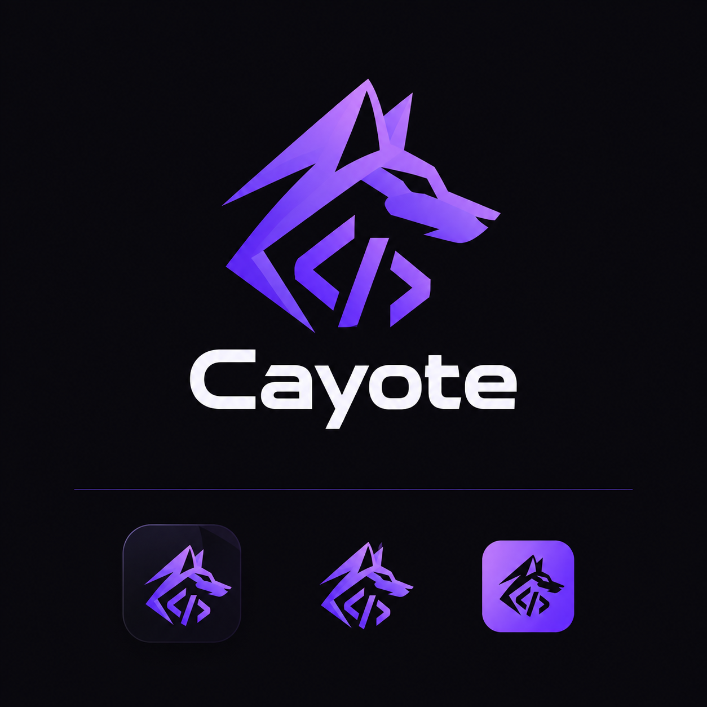

<p align="center">
  
</p>

# Coyote

Coyote is a programming language and toolchain: a C++ compiler that produces a textual,
versioned intermediate language (ML), and the Pixel Virtual Machine (PVM) that verifies and runs
it. Source files use the `.coy` extension.

```
# samples/fibonacci.coy
hand:con println(string text)

method fib(int n) : int {
    if (n < 2) { return n }
    return fib(n - 1) + fib(n - 2)
}

var i = 0
while (i < 10) {
    println("fib(" + i + ") = " + fib(i))
    i = i + 1
}
```

```
$ coyote build samples/fibonacci.coy -o fib.ml
$ pvm fib.ml
fib(0) = 0
fib(1) = 1
...
fib(9) = 34
```

`samples/hello.coy` is the standard "Hello world" (`use "Standard"` + `Shell.PrintLine`); `samples/hello_host.coy` does the same with a raw `hand:` host declaration and no library.

## Implementation status

Coyote is an early work in progress. Only what is marked "working" exists.

| Component | Status |
|-----------|--------|
| Compiler front end (`coyote`) | **Working** for a subset: `int`/`string`/`boolean`/`double`/`char`/`Guid`, `T?` and `null` (`??`, `!`), `obj`, `dyn`, `map<K,V>`, `var`, assignment, expressions (arithmetic, comparison, short-circuit logic, string concatenation), `if`/`else`/`while`/`for`, `namespace`, `use` and `export` across files, namespaces, installed packages and libraries, `++`/`--`, compound assignment on elements, interpolated strings `$"...{x}..."`, several syntax errors per run, `for … in` over arrays, `break`/`continue`, compound assignment, explicit conversions (`int(x)`, `string(x)`, …), `method` with parameters, return values and recursion, `array<T>` (literals, `new`, indexing, `length`, `push`, `copy`), `hand:` host declarations ([language](docs/language.md)) |
| ML generation with `.coy` line mapping | **Working**: the compiler emits ML v5, or v7 when a program uses class hierarchies (v6 = function values: the PVM runs them, the compiler does not emit them yet) ([spec](docs/ml-spec.md)); the PVM accepts ML v1 to v7 |
| ML loader and verifier | **Working**, including operand-stack typing across branches and loops |
| PVM interpreter, call frames, host registry with permissions | **Working** (`con.print`, `con.println`); runtime errors for division by zero, `int` overflow, call depth, array bounds/null/size, heap limit |
| Classes, models, constructors, properties, static fields/methods, `public`/`private`/`protected` | **Working** (ML v5 `class`/`global`/`newobj`/`getfield`...; method overloading since 0.6.1) ([docs](docs/language.md)) |
| Inheritance, interfaces, `override`/`base`, `as`/`is` | **Working** (single base class + interfaces, virtual methods through compiler-generated dispatchers; ML v7 only for programs that use it) ([docs](docs/language.md)) |
| Generics (classes, interfaces, top-level methods) | **Working** by compile-time expansion; type arguments of generic methods are inferred from the arguments since 0.6.1 (`First(xs)`; `First<int>(xs)` still works), no generic methods inside classes ([docs](docs/language.md)) |
| Dead-code removal | **Working** (unreachable methods and classes are dropped from the ML; `--keep-unused` disables) ([docs](docs/compiler.md)) |
| Variadic parameters, extension methods | **Working** (compile-time rewrites; [docs](docs/language.md)) |
| Libraries: `use`, `.lib` files, Standard libraries (`Standard.IO`, `.Math`, `.Text` with extension methods, `.Time`, `.Random`, `.Collections`, `.Testing`, HTTP, ...), host functions with return values | **Working**; `.lib` is a **source bundle** (compiled/linked libs are not implemented) ([docs](docs/libraries.md)) |
| Closures/lambdas, LINQ-like APIs | Not implemented (lambdas need function values in ML, which do not exist yet; LINQ-like APIs depend on them) |
| Garbage collector | **Working** for arrays, maps, boxed values and class instances: precise, non-moving mark-and-sweep; `--gc-stress`, `--gc-stats`, `--heap-limit` ([design](docs/architecture.md)). Strings are copied by value and are not on the heap. Nothing with finalizers or native resources exists yet |
| LLVM native backend (`coyote-llvm`) | **Working for a small subset** (int/boolean/string, calls, control flow, console print); outside the subset it falls back to a **bundled executable** (the PVM plus the program) unless `--native-only`; same call-depth limit as the PVM and reference-counted strings since 0.6.0.9 ([docs](docs/llvm.md)). The installer ships clang (llvm-mingw); **not yet verified on Windows** |
| `cpx` (workflows, `.cyproj` / `packages.json` schema v1) | **Working**: `cpx start`/`build`/`list`/`check`, project output and run settings from the project file ([docs](docs/cpx.md), [projects](docs/projects.md)); dependencies are rejected as not implemented. Windows process code is written but never compiled on Windows |
| `cpm` (dependencies, lock file) | **Working** for `path` and `git` dependencies: deterministic resolution, integrity-checked lock file, `install`/`update`/`lock`/`verify`/`init`/`layout` ([docs](docs/cpm.md)). `url`/registry providers are interfaces only. Installed packages are consumed through `use "name"` |
| `cdt` (check/tokens/ast/fmt/doctor) | **Working** ([docs](docs/cdt.md)); the formatter is conservative (re-indents, never changes tokens) |
| Coyote Studio (desktop IDE) + debugger | **Working on Linux under Electron**: editor with context-aware completion (namespaces, inheritance, generics), Project Manager (`.cyproj`), Build/Rebuild/Clean, separate app window for debugging, Settings page with themes, `pvm --debug` debugger; UI-tested. The Windows package is built by CI and **never run on Windows** ([studio](docs/studio.md), [debugging](docs/debugging.md)) |
| Windows installer (`Coyote-Setup-<version>.exe`) | Script compiled and lifecycle-tested under Wine (install, update detection, downgrade refusal, repair, uninstall); the CI job producing it **has not run** ([studio](docs/studio.md)) |
| VS Code extension | Written and unit-tested (diagnostic mapping, grammar scopes with the real TextMate engine); **never loaded in VS Code**; no language server ([docs](editors/vscode/README.md)) |
| `coyote` as unified entry point | **Working**: `build`, `check`, `run`, and `coyote pvm|cpx|cpm|cdt|llvm ...` forward to the tool next to it |
| GitHub Actions workflow | Written ([ci.yml](.github/workflows/ci.yml)); **not yet run on GitHub** |

Known limits: ML has no instruction or time limit, so a verified program can loop forever;
`method` syntax is provisional. Input limits: source 4 MiB, ML 32 MiB, nesting 256, expression depth 1000.

### What has been verified

Version 0.6.1 (Linux, GCC, warnings as errors): a program with overloads of top-level, instance, static, inherited, interface and extension methods (variadic, `int?`/`double` ranking, `obj` fallback), the ambiguity and no-match errors, duplicate signatures, generic inference (literals, locals, arrays, `Box<T>`, `T?`, `T...`, nesting, the two error cases), braceless `if`/`else`/`while`/`for`, `for (k in map)`, and `tools/diff-native.sh` on an int/string/boolean program using overloads, inference and braceless bodies (SAME as the PVM) plus the 0.6.0.9 programs t01-t09 (SAME). Not done: Studio was not changed (its JS index ignores overloads), nothing ran on Windows or GitHub, and the old 0.5.x test suite no longer exists.

This repository carries no test suite (see [FORAI.md](FORAI.md)), so each version is checked with small tests for what changed.
Version 0.6.0 (and 0.6.0.9 for the native backend) was checked on Linux (GCC, warnings as errors) with: a multi-folder project using namespaces (`use` of two namespaces,
same-namespace neighbours without `use`, a private method staying private, a missing namespace, an ambiguous name, `import` and a misplaced
`namespace` rejected with their messages), the parser's error recovery (six errors found in one file, bad interpolated strings),
`++`/`--`, compound assignment on elements and interpolated strings in one program, the three samples, and a native build of
`fibonacci`. 0.6.0.9 added a PVM-versus-native comparison of 24 programs (stdout, stderr, exit code; call-depth boundary at 4998/4999 nested calls; a 3M-iteration string loop; sanitizer and valgrind runs). The 0.5.x suite (314 CTest cases, also run under ASan/UBSan, and fuzzing of 3,000 mutated programs) was run before it was
removed; nothing in 0.6.0 has been re-run against it, and the Studio changes of 0.6.0 were only syntax-checked and
unit-tested at the language-index level (not run in Electron).

Not verified: macOS, Windows, ARM (CI matrix entries that have not run), and any GitHub Actions run.

## Build

Requirements: CMake 3.20+, a C++17 compiler (GCC, Clang or MSVC). No other dependencies.

```
cmake -S . -B build -DCMAKE_BUILD_TYPE=Release
cmake --build build --parallel
ctest --test-dir build --output-on-failure
./build/coyote build samples/hello.coy -o hello.ml && ./build/pvm hello.ml
```

(On Windows with Visual Studio generators add `--config Release` to build and `-C Release` to ctest.)

## CI

`.github/workflows/ci.yml` builds with the tests switched off (`-DCOYOTE_BUILD_TESTS=OFF`) because the repository carries no tests (see [FORAI.md](FORAI.md)). It builds on Linux x86_64, Linux arm64, macOS arm64 and Windows x86_64, uploads one archive per platform, packages the VS Code extension, and builds the Windows installer (`Coyote-Setup-<version>.exe`). On a pushed tag `v*` it publishes a GitHub release with all of these and a `SHA256SUMS.txt`.

There is no test suite in the repository on purpose: it kept growing and slowed down AI-assisted work. [FORAI.md](FORAI.md) explains the policy (write only the tests relevant to the change at hand). The full suite remains in git history (commit `97453e2` and earlier: `git show 97453e2:tests/CMakeLists.txt`, `git checkout 97453e2 -- tests`).

* Permissions are read-only except the release job (`contents: write`).
* Actions are pinned to exact version tags, **not yet commit SHAs**.
* Nothing in this workflow has been verified by a successful run yet.

## Documentation

* [Language (what is implemented)](docs/language.md)
* [Libraries, `use` and the Standard library](docs/libraries.md)
* [Projects and `.cyproj` files](docs/projects.md)
* [Compiler options and dead-code removal](docs/compiler.md)
* [LLVM backend](docs/llvm.md)
* [Coyote Studio and the installer](docs/studio.md)
* [Debugging protocol](docs/debugging.md)
* [ML specification](docs/ml-spec.md)
* [Architecture](docs/architecture.md)
* [Brand assets](assets/brand/README.md)

## License

No license has been chosen yet; add a `LICENSE` file.
